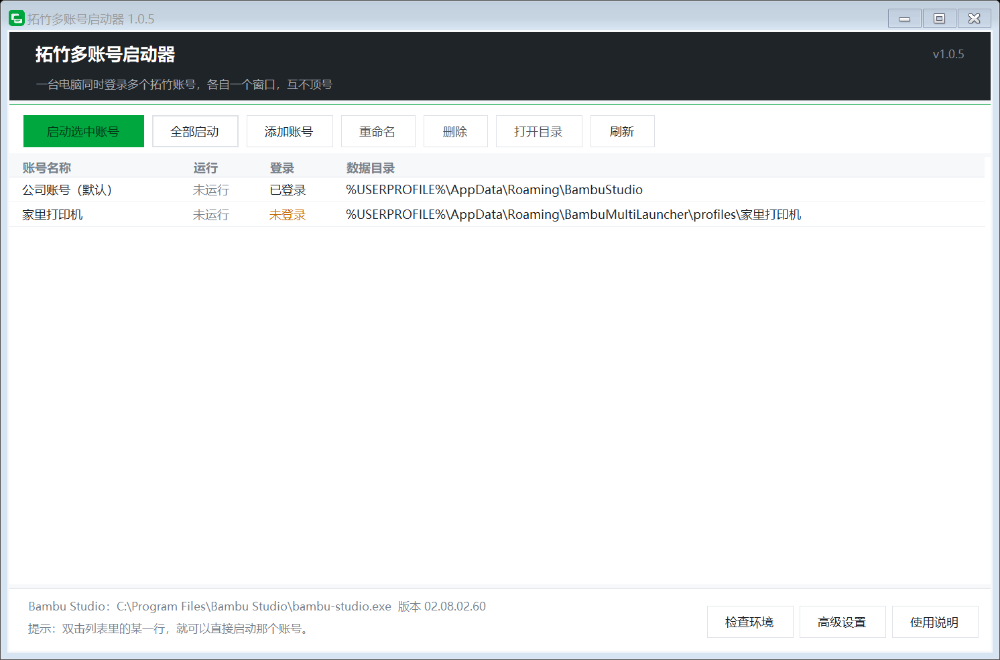
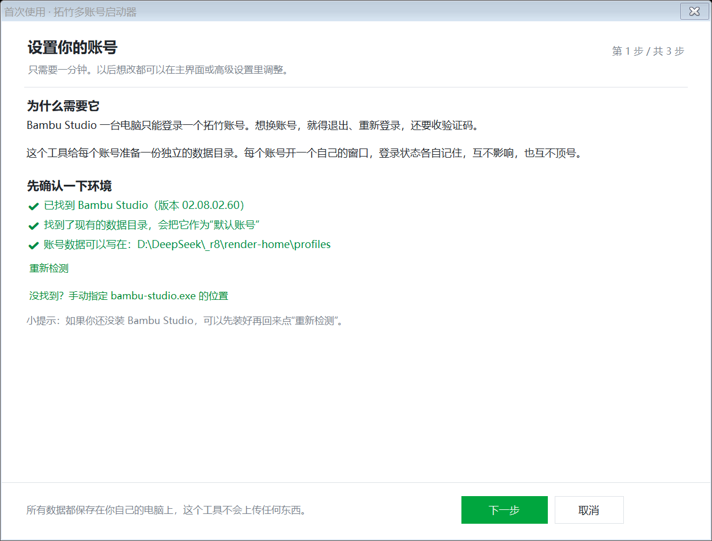
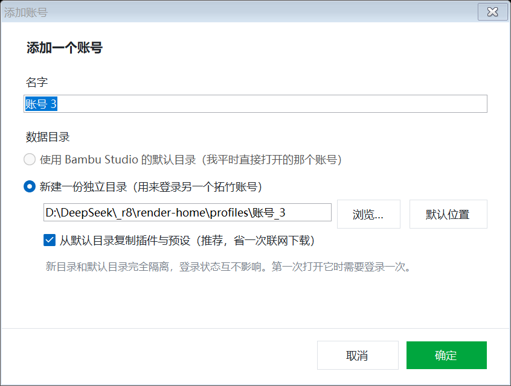
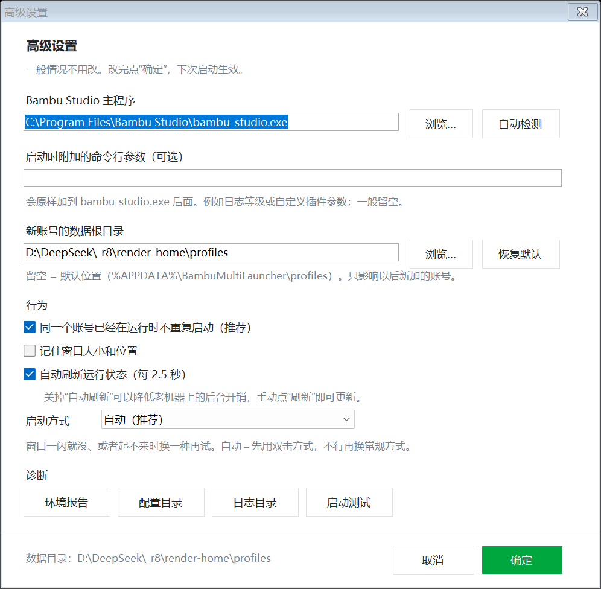
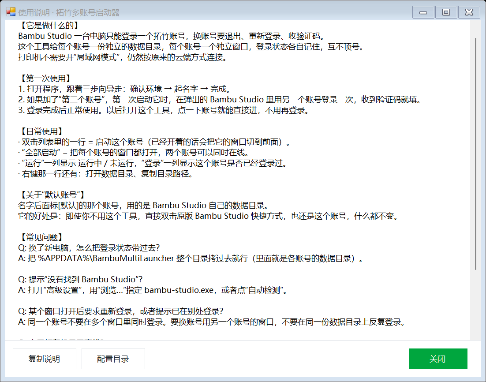

# 拓竹多账号启动器 · Bambu Multi-Account Launcher

**一台 Windows 电脑，同时登录多个拓竹（Bambu Lab）账号，各自一个 Bambu Studio 窗口，互不顶号。**

不用退出重新登录，不用每次收验证码，也不用开局域网模式——打印机照旧按云端方式连接，Bambu Handy 照样能看。



---

## 它解决什么问题

Bambu Studio 一个用户目录只能存一个账号的登录状态。你有两个账号（比如"公司的机器"和"家里的机器"），就得来回退出、重新登录、收验证码。

Windows 的"多开"技巧对 Bambu Studio 没用：同一份数据目录再启动一次，打开的还是同一个窗口、同一个账号。真正需要隔离的是**数据目录**（登录凭据 `BambuNetworkEngine.conf` 就在里面）。

这个工具就是干这件事的：给每个账号准备一份独立的数据目录，启动时用 Bambu Studio 自带的 `--datadir` 参数指定进去。每份目录有自己的登录状态，互相看不见，也就不会顶号。

- 原来的账号**完全不动**，仍然是 Bambu Studio 的默认数据目录（双击原版快捷方式也还是它）
- 新加的账号各自一份目录，第一次打开时登录一次，之后一直记住
- 两个窗口可以同时在线，各自打印各自的机器

## 功能

| | |
|---|---|
| 首次向导 | 自动检测 Bambu Studio、现有数据目录，三步完成配置 |
| 多开即用 | 双击一行就启动那个账号；"全部启动"一次开满 |
| 防重复启动 | 同一账号第二次点击不会重复开窗口，而是把已有窗口切到前面 |
| 状态一眼看到 | "运行中/未运行"、"已登录/未登录" 实时刷新 |
| 不动原账号 | 默认账号沿用 Bambu Studio 原目录，删掉本工具也不留痕迹 |
| 不碰凭据 | 复制插件/预设时会主动删掉目标目录里的登录文件，绝不会把账号串了 |
| 高级设置 | 手动指定程序位置（可多版本里选）、附加启动参数、换数据根目录、切换启动方式、关掉去重或自动刷新 |
| 两种启动方式 | "双击方式"（和双击快捷方式一样）与"常规方式"（直接创建进程）；默认自动，一种起不来就换另一种再试 |
| 认旧数据 | 启动时自动扫描以前留下的账号目录（含最早那版 PowerShell 脚本建的），登录状态照旧 |
| 启动诊断 | 窗口没起来时，右键“诊断启动问题”：试启动、看退出原因、必要时自动修 `single_instance` 再试一次 |
| 内置说明 | 离线也能看的使用说明和常见问题 |
| 零依赖 | 单个 exe，.NET Framework 4.x（Win10/11 自带），不需要安装运行时 |

## 下载与使用

1. 到 [Releases](../../releases) 下载 `拓竹多账号启动器-v1.0.5.zip`，解压到任意目录（**别放在会同步的网盘目录里**，两份数据目录加起来 400 MB 以上）。
2. 双击 `拓竹多账号启动器.exe`。
3. 第一次会弹三步向导：
   - **第 1 步**：自动检查是否找到 Bambu Studio、是否找到现有数据目录。都打勾就下一步。
   - **第 2 步**：给账号起名字（只是给你自己看的），如果还需要一个账号，勾上"我再添加一个独立账号"。
   - **第 3 步**：完成。默认不自动开窗口；想立刻试一下可以勾"完成后顺带打开默认账号的窗口"。
4. 新账号的窗口第一次打开时，在里面登录那个账号（收一次验证码）。**只需要这一次**。
5. 以后打开本工具，点一下账号就行。

> Windows 可能提示"已保护你的电脑"（SmartScreen）。因为这是没有买代码签名的个人作品，点"更多信息 → 仍要运行"即可。源码全部在本仓库，可自行编译核对。

## 界面

| 首次向导 | 添加账号 |
|---|---|
|  |  |

| 高级设置 | 内置说明 |
|---|---|
|  |  |

## 文档

| 文档 | 内容 |
|---|---|
| [产品文档](docs/产品文档.md) | 完整说明：功能与界面、数据布局、实现原理（`--datadir`、`single_instance`、两种启动方式）、源码逐文件导览、关键流程、编译/自检/出图、已知限制、可疑点清单 |
| [测试指南](docs/测试指南.md) | 可执行的测试矩阵（T1–T11 + 回归清单 + 报告模板），按"前置条件 / 操作 / 期望 / 判定"组织，可直接照着验收 |
| [源码全文](docs/源码全文.md) | `src/` 下 16 个源文件的完整文本（含行数索引），便于逐行审阅 |
| [使用手册](docs/使用手册.md) | 面向用户的逐步操作说明 |
| [常见问题](docs/常见问题.md) | 顶号、找不到 Studio、窗口一闪就没（0xC0000409）、老版本点了没反应等 |
| [原理与限制](docs/原理与限制.md) | 早期整理的原理笔记与边界（细节以产品文档为准） |
| [视频脚本-双平台](docs/视频脚本-双平台.md) | B站 4 分钟正片 + 抖音 55 秒版的分镜、口播全文、AI 生成提示词、发布与引流话术 |
| [GitHub发布指南](docs/GitHub发布指南.md) | 从零上传到 GitHub 的逐步操作：身份配置、提交、建仓库、推送授权、发 Release、常见报错表 |
| [CHANGELOG](CHANGELOG.md) | 各版本改了什么 |

## 数据放在哪

| 内容 | 位置 |
|---|---|
| 程序本体 | 你解压的位置 |
| 配置 | `%APPDATA%\BambuMultiLauncher\settings.ini`（纯文本，可手改） |
| 各账号数据目录 | `%APPDATA%\BambuMultiLauncher\profiles\<账号名>\` |
| 日志 | `%APPDATA%\BambuMultiLauncher\logs\` |
| 默认账号 | `%APPDATA%\BambuStudio`（Bambu Studio 自己的目录，本工具只读不动） |

想换位置：设环境变量 `BAMBUMULTI_HOME=你的路径` 就是便携模式，配置和数据都跟着走（U 盘、移动硬盘都行）。

## 原理

```
bambu-studio.exe                                  ← 默认账号（公司）
bambu-studio.exe --datadir "...\profiles\家里打印机"  ← 独立账号（家里）
```

`--datadir` 是 Bambu Studio 自带的参数（从 PrusaSlicer 继承来的）。它会把**整个用户目录**换掉，包括登录凭据 `BambuNetworkEngine.conf`。所以两份目录 = 两个完全独立的登录状态。

细节、验证方法和限制写在 [docs/原理与限制.md](docs/原理与限制.md)。

## 从源码编译

需要 .NET Framework 4.x 自带的 `csc.exe`（Win10/11 都有），不需要装 Visual Studio：

```bat
build.bat
```

产物在 `dist\拓竹多账号启动器.exe`。源码是 **C# 5** 语法，用 `csc` 直接编译，方便任何人再审一遍。

自检（不弹界面，17 项：配置读写、参数解析、复制隔离、单实例修补、旧数据识别、启动去重）：

```bat
dist\拓竹多账号启动器.exe --selftest build\selftest
type build\selftest\selftest.log
```

离屏渲染各界面（开发用，没有显示器也能看排版）：

```bat
dist\拓竹多账号启动器.exe --render build\render
```

## 目录结构

```
BambuMultiLauncher/
├─ README.md               本文件
├─ LICENSE                 GPL-3.0 许可证
├─ CHANGELOG.md            版本变更记录
├─ NOTICE                  第三方名称与免责声明（与拓竹科技无关）
├─ build.bat               一键编译
├─ src/                    源码（C# 5，共 16 个文件）
│  ├─ Program.cs           入口：单实例、全局异常、--selftest / --render
│  ├─ Core.cs              路径常量、日志、Profile、Settings（INI 读写）
│  ├─ StudioLocator.cs     找 bambu-studio.exe（App Paths / 卸载表 / 注册表扫描 / 各盘目录）
│  ├─ LaunchService.cs     启动、去重、找运行中实例、复制插件、打开目录
│  ├─ UiTheme.cs           配色、字体、按 DPI 缩放的控件工厂、可滚动布局
│  ├─ MainForm.cs          主界面（自绘列表）
│  ├─ FirstRunForm.cs      三步向导
│  ├─ AccountForm.cs       添加/重命名账号
│  ├─ AdvancedForm.cs      高级设置 + 环境报告 + 启动测试
│  ├─ Diagnostics.cs       启动诊断：试启动、看退出、自动修 single_instance
│  ├─ LegacyScanner.cs     扫描并导入以前留下的账号数据目录
│  ├─ Widgets.cs           双缓冲列表、多版本选择框
│  ├─ HelpForm.cs          内置说明
│  ├─ SelfTest.cs          --selftest 自检用例
│  ├─ Render.cs            --render 离屏截图
│  └─ AssemblyInfo.cs      exe 版本信息
├─ docs/                   产品文档、测试指南、源码全文、使用手册、常见问题、原理与限制、
│                          视频脚本、GitHub 发布指南、截图与历史测试材料
├─ tests/                  诊断试验程序（启动方式/打开目录对比，见 tests/README.md）与自检桩
├─ tools/                  图标生成脚本、自检桩源码与其编译脚本（make-sleeper.bat）
└─ .github/                CI（编译 + 自检 + 上传产物）与 issue 模板
```

## 常见问题

见 [docs/常见问题.md](docs/常见问题.md)。几个高频的：

- **会不会顶号？** 不会，每个账号一份独立数据目录。但**同一个账号**不要在两台电脑/两个窗口反复登录，那是拓竹服务器那边的限制。
- **打印机要开局域网模式吗？** 不用。本工具不碰网络，Bambu Studio 还是走云端。Bambu Handy 照常能看打印机。
- **登录状态能带到新电脑吗？** 把 `%APPDATA%\BambuMultiLauncher` 整个拷过去。
- **删掉会留下什么？** 删程序目录 + `%APPDATA%\BambuMultiLauncher` 就干净了；`%APPDATA%\BambuStudio` 是你原来的，别删。

## 免责

- 本工具只做"用不同数据目录启动 bambu-studio.exe"这一件事，不联网、不读不传任何凭据、不修改 Bambu Studio 的安装文件。
- 与拓竹科技（Bambu Lab）无关，非官方工具。Bambu Studio 的目录结构可能随版本变化，升级后如遇异常请提 issue。
- 请自行确认账号使用符合你所在环境的规定。

## 许可

[GPL-3.0](LICENSE)：可以自由使用、修改、分发，包括商用；但**分发修改版时必须同样以 GPL-3.0 公开源码**，且不附带任何担保。名称与免责声明见 [NOTICE](NOTICE)——本工具与拓竹科技（Bambu Lab）无关，是非官方社区作品；许可只授予著作权层面的权利，不授予任何商标使用权。
