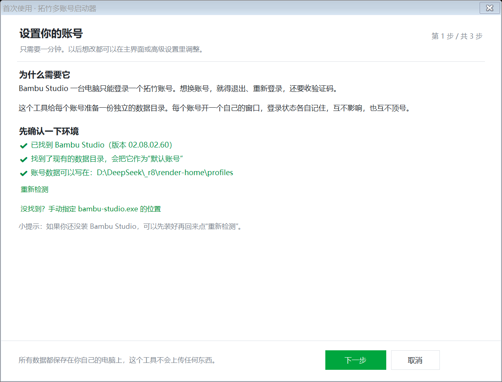
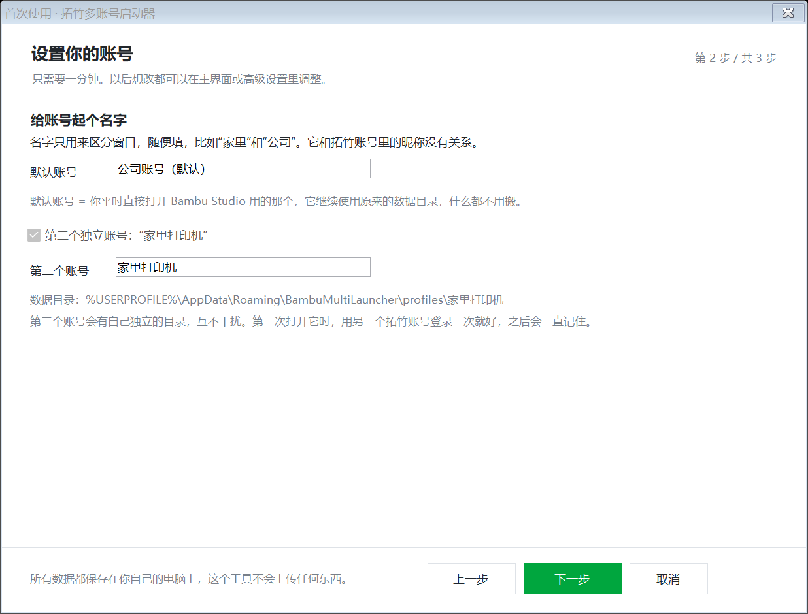
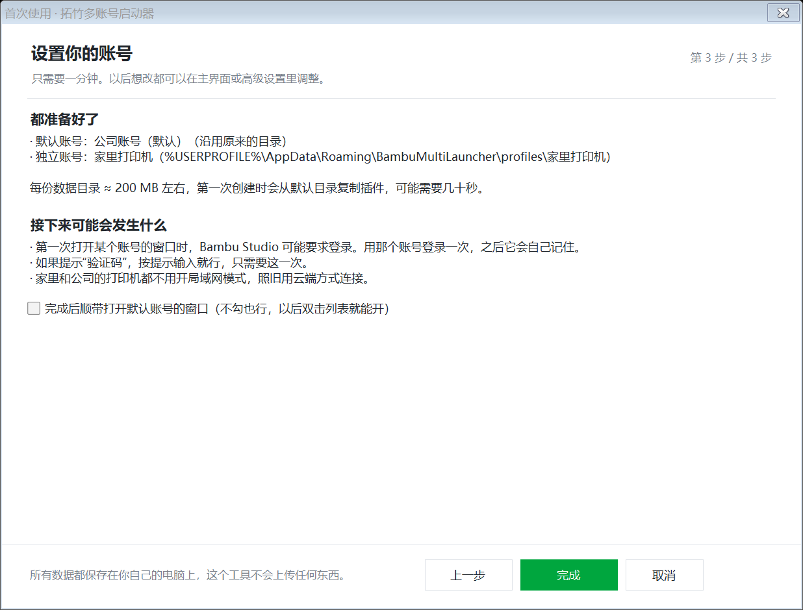
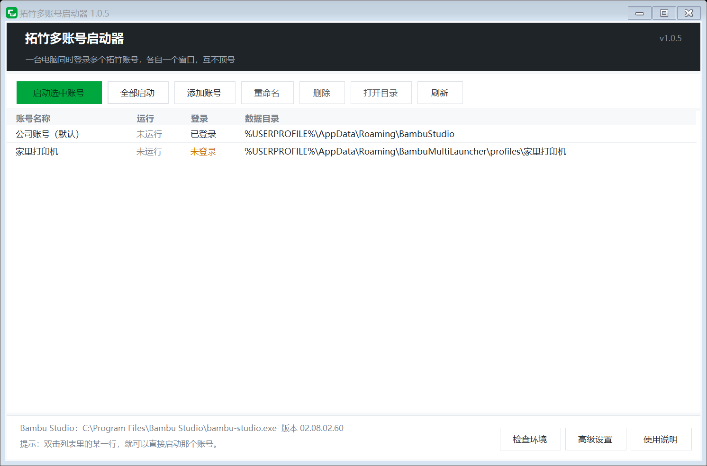
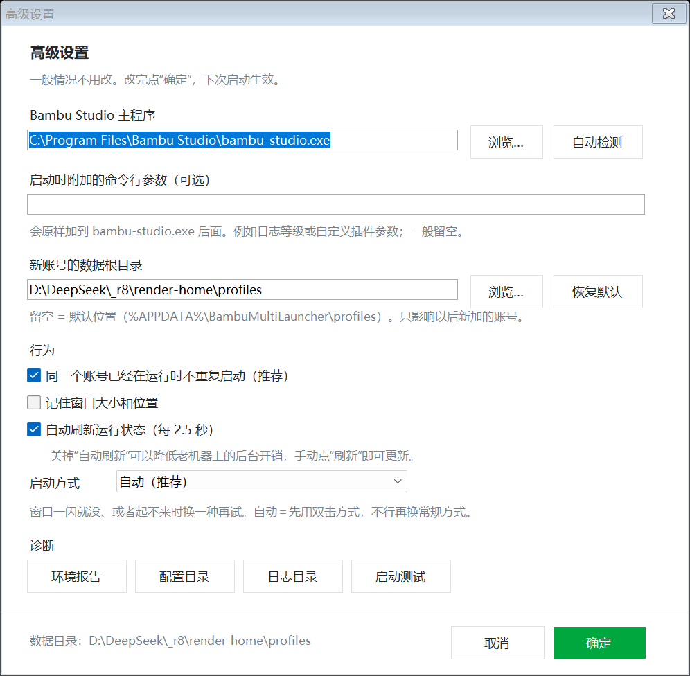

# 拓竹多账号启动器 · 产品文档

版本：1.0.5
文档性质：产品说明 + 实现原理 + 源码导览 + 测试交接说明
适用范围：本项目源码树 `BambuMultiLauncher`（v1.0.5，16 个源文件合计 6209 行 C#）

---

## 0. 这份文档是给谁看的、怎么用

这份文档有三个读者，按需跳读：

| 读者 | 建议阅读顺序 |
| --- | --- |
| 想用这个工具的用户 | 第 1、2、3、4 章 |
| 想改代码 / 判断能不能改的开发者 | 第 5、6、7、8 章 + 第 10 章 |
| **接受测试委托、要找出 bug 的 AI 或工程师** | 第 2 章（跑起来）→ 第 3、4 章（知道什么样算对）→ 第 5、6 章（知道它为什么这么做）→ **`docs/测试指南.md`（逐条执行）**→ 第 9、10 章（已知限制与可疑点，避免把"设计如此"当 bug 报） |

配套文件：

- `docs/测试指南.md` —— 可执行的测试矩阵与判定标准，测试时以它为操作手册。
- `docs/使用手册.md`（面向用户）、`docs/常见问题.md`、`docs/原理与限制.md`（早期版本，内容已被本文档覆盖并可对照）。
- `tests/README.md` —— 仓库里那 6 个"诊断试验程序"的说明（不属于产品，不进发布包）。

---

## 1. 产品是什么

**一句话**：一台 Windows 电脑上同时登录多个拓竹（Bambu Lab）账号，每个账号一个独立窗口，各自记住登录状态，互不顶号，也不用反复收验证码。

### 1.1 它解决的具体问题

Bambu Studio 把"账号登录状态"和"首选项、设备列表、预设、插件"一起放在同一个数据目录里（默认 `%APPDATA%\BambuStudio`）。
同一台电脑上：

- 只登录一个账号 → 有第二个账号（比如公司账号 + 家里账号）就只能反复退出、重新登录、收验证码；
- 用同一个数据目录再启动一次 Bambu Studio → 新进程把启动请求交给已有窗口，然后自己退出，**不会**出现第二个窗口。

本工具的做法：给"非默认账号"各自准备一份独立的数据目录，启动时用 Bambu Studio 自带的 `--datadir` 参数把窗口指向那份目录。于是每份目录 = 一个账号 = 一个窗口 = 一套独立登录状态。

### 1.2 它不做什么

明确划清边界，测试时不要按这些方向提需求：

- **不**做打印任务转发、不共享打印机、不碰云端协议；
- **不**改 Bambu Studio 的安装文件、**不**注入 DLL、**不**hook 网络流量；
- **不**托管账号密码，**不**联网，**不**上传任何数据（除了 Bambu Studio 自己被启动后照常联网）；
- **不**要求打印机开"局域网模式"，云端模式照常用；
- 不解决"同一个账号在多台电脑同时登录"的问题。

### 1.3 系统要求

| 项目 | 要求 |
| --- | --- |
| 操作系统 | Windows 10 / 11（x64）。源码只用到 .NET Framework 4.x + WinForms，理论上 Windows 8.1 也能跑，但未验证 |
| 运行时 | .NET Framework 4.6+（Win10 1511 之后系统自带，**无需安装**） |
| Bambu Studio | 已安装。测试覆盖 02.07.01.62 与 02.08.02.60；更老版本见 5.4 节 |
| 权限 | 普通用户权限即可（写 `%APPDATA%`）。不需要管理员 |
| 磁盘 | 每个额外账号目录约 200 MB（含插件与预设） |
| 网络 | 首次登录、首次下载网络插件时需要 |

---

## 2. 快速开始

### 2.1 拿到程序

- 发布包：`dist\拓竹多账号启动器-v1.0.5.zip` → 解压得到 `拓竹多账号启动器.exe`（单文件，约 155 KB）。**绿色版，不写系统目录，卸载就是删掉 exe 和 `%APPDATA%\BambuMultiLauncher`。**
- 或者自己编译：双击 `build.bat`（需要系统自带 `csc.exe`，见 8.1 节）。

### 2.2 第一次打开（三步向导）



1. **确认环境**：自动检测 Bambu Studio 主程序、已有数据目录、账号目录可写位置。三项都打勾即可继续；找不到可以手动指定 `bambu-studio.exe`。
2. **给账号起名字**（名字只用于区分窗口，和拓竹账号里的昵称无关）：

   

   - 第一个是"默认账号"，直接用 Bambu Studio 原来的数据目录，**什么都不用搬**；
   - 勾选"第二个独立账号"可以顺手建好第二份目录（会从默认目录复制插件与预设，省一次联网下载）。
3. **完成**：

   

   默认**不会**自动打开窗口（避免一口气开出好几个窗口）。完成后主界面里就能看到账号。

### 2.3 日常使用



| 想做的事 | 操作 |
| --- | --- |
| 开某个账号的窗口 | 双击那一行，或选中后点"启动选中账号" |
| 两个账号同时开 | 点"全部启动" |
| 再添加一个账号 | "添加账号" → 起名 → 选"新建一份独立目录" |
| 改名字 | "重命名" |
| 从列表里移除 | "删除"（**只移除列表，不删数据目录**；默认账号不可删） |
| 打开某账号的数据目录 | 选中后"打开目录"，或右键 → "打开数据目录" |
| 窗口一闪就没 / 起不来 | 右键 → "诊断启动问题…"，把弹出报告发给开发者 |
| 看环境信息 | 右下"检查环境" |
| 改路径/启动方式等 | 右下"高级设置" |

### 2.4 第一次用新账号时要登录一次

新建的账号目录里没有登录凭据。第一次打开该窗口时，Bambu Studio 会要求登录——**用那个账号登录一次、收一次验证码**，之后这份目录里就有了凭据，以后都不用再登录（除非长期不用、凭据过期，或手动删了 `BambuNetworkEngine.conf`）。

---

## 3. 界面说明

### 3.1 主窗口结构

```
┌──────────────────────────────────────────────────────────┐
│ 拓竹多账号启动器                                   v1.0.5 │  ← 深色顶栏（品牌绿分隔线）
│ 一台电脑同时登录多个拓竹账号，各自一个窗口，互不顶号      │
├──────────────────────────────────────────────────────────┤
│ [启动选中账号] [全部启动] [添加账号] [重命名] [删除]      │  ← 工具栏
│ [打开目录] [刷新]                                        │
├──────────────────────────────────────────────────────────┤
│ 账号名称        运行     登录      数据目录               │  ← 自绘表头（PageBack 背景）
│ 公司账号（默认） 未运行   已登录    %USERPROFILE%\AppData… │
│ 家里打印机      未运行   未登录    %USERPROFILE%\AppData… │  ← 悬停高亮 / 选中浅绿
├──────────────────────────────────────────────────────────┤
│ Bambu Studio: C:\Program Files\...\bambu-studio.exe 版本…│  ← 状态条左侧：主程序与版本
│ 提示：双击列表里的某一行，就可以直接启动那个账号。        │  ← 动态提示（成功绿/警告橙/错误红）
│                        [检查环境] [高级设置] [使用说明]   │  ← 状态条右侧
└──────────────────────────────────────────────────────────┘
```

### 3.2 列表列的语义

| 列 | 取值 | 判定方式（源码位置） |
| --- | --- | --- |
| 账号名称 | 用户起的名字；默认账号带"（默认）"后缀 | `Profile.Name` / `IsDefault` |
| 运行 | `运行中`（绿）/ `未运行`（灰） | `LaunchService.IsRunning(p)`：先读 `state\p<id>.pid` 并校验进程名，再查 `QueryInstances()` 快照的 `DataDir` |
| 登录 | `已登录`（黑）/ `未登录`（橙） | `Profile.HasLogin`：数据目录里 `BambuNetworkEngine.conf` 存在且长度 > 0 |
| 数据目录 | 实际路径；位于用户目录下的会显示成 `%USERPROFILE%\...` | `Profile.ShortDir` |

"登录"列只是**看文件在不在**，不代表凭据一定有效（凭据过期仍显示"已登录"）。这是刻意的：不去解密、不联网校验。

### 3.3 右键菜单

| 项 | 行为 |
| --- | --- |
| 启动这个账号 | 同双击 |
| 诊断启动问题… | 跑 `LaunchDiagnostics.Run`，弹报告（见 7.4） |
| 打开数据目录 | `OpenFolderSafely`，失败会弹框给出路径与原因 |
| 复制数据目录路径 | 写剪贴板 |
| 删除 | 移出列表（默认账号禁用） |

### 3.4 高级设置



| 项 | 说明 | 底层字段 |
| --- | --- | --- |
| Bambu Studio 主程序 | 指定 `bambu-studio.exe`；"自动检测"会在**全注册表 + 常见目录 + 所有固定盘**里找（见 5.7）；找到多个时弹选择框 | `settings.StudioExe` |
| 启动时附加的命令行参数 | 原样拼在 `--datadir "…"` 之后，一般留空 | `settings.ExtraArgs` |
| 新账号的数据根目录 | 之后新建账号的默认落点；留空 = `%APPDATA%\BambuMultiLauncher\profiles` | `settings.ProfileRoot` |
| 同一账号已经在运行时不重复启动 | 去重开关 | `settings.DedupeLaunch` |
| 记住窗口大小和位置 | 关闭后每次都是默认尺寸并居中 | `settings.RememberWindow` + `WindowX/Y/W/H` |
| 自动刷新运行状态 | 打开时每 2.5 秒刷新一次列表运行状态；关闭会省后台开销 | `settings.AutoRefresh` |
| 启动方式 | 自动（推荐）/ 双击方式 / 常规方式（见 5.6） | `settings.LaunchMethodValue`（0/1/2） |
| 环境报告 | 生成一段可复制的文本（系统、Studio 候选、数据目录、账号、运行实例） | `EnvironmentReport.Build` |
| 配置目录 / 日志目录 | 在资源管理器里打开；打不开会明确报错 | `LaunchService.OpenFolder(path, out error)` |
| 启动测试 | 对默认（或第一个）账号实跑一次启动诊断 | `LaunchDiagnostics.Run` |

界面上所有内容都在一个竖向滚动画布里（`Ui.Stack` + `ScrollCanvas`），窗口高度 660×624（按 DPI 缩放）。

### 3.5 使用说明

内置纯文本说明（`HelpForm.Guide()`），右侧可"复制说明"，也直接指向配置目录。不联网，所以说明书是编进 exe 的。

---

## 4. 数据放在哪

### 4.1 目录总表

| 路径 | 内容 | 谁写 |
| --- | --- | --- |
| `%APPDATA%\BambuMultiLauncher\settings.ini` | 全部配置（见 4.2） | 本工具 |
| `%APPDATA%\BambuMultiLauncher\logs\app-YYYYMMDD.log` | 文本日志，每天一个文件 | 本工具 |
| `%APPDATA%\BambuMultiLauncher\state\p<id>.pid` | "上次是我启动的这个账号，PID 是 N" | 本工具 |
| `%APPDATA%\BambuMultiLauncher\profiles\<账号名>\` | 非默认账号的数据目录（= 一个账号） | Bambu Studio 为主 |
| `%APPDATA%\BambuStudio\` | **默认账号**的数据目录，完全交给 Bambu Studio | Bambu Studio |

> 默认账号的目录**不动**：不复制、不改名、不清理。这样即使不用本工具，双击原来的 Bambu Studio 快捷方式，还是那个账号、原来的配置。

### 4.2 `settings.ini` 完整格式

```ini
; 拓竹多账号启动器 配置文件
; 可以直接手动编辑，改完重新打开程序生效。
[app]
studioexe=C:\Program Files\Bambu Studio\bambu-studio.exe
extraargs=
profileroot=
lastprofile=2
firstrun=1
remember=1
dedupe=1
autorefresh=1
launchmethod=0
ignoreddirs=
windowx=120
windowy=80
windoww=980
windowh=620

[profile:1]
name=公司账号
dir=C:\Users\me\AppData\Roaming\BambuStudio
default=1
note=

[profile:2]
name=家里打印机
dir=C:\Users\me\AppData\Roaming\BambuMultiLauncher\profiles\家里打印机
default=0
note=
```

规则（实现：`src/Core.cs` 的 `Settings` / `IniFile`）：

- 文件以 **UTF-8 带 BOM** 写出，中文账号名、中文路径都不需要转义；写回时把所有换行压成空格（`OneLine`）。
- 布尔值写成 `1` / `0`；`true/false` 也能读。
- `;` 与 `#` 开头的行是注释；`[section]` 顺序按首次出现保留。
- 键名大小写不敏感。
- `[profile:<id>]` 的 `id` 在文件内部唯一，与显示顺序无关；加载时按 `default` 优先、其余按 `id` 升序排序（`CompareProfiles`）。
- `dir` 为空的账号会被丢弃（防止手改出错导致空行）；相对路径会按配置目录（`%APPDATA%\BambuMultiLauncher`）补成绝对路径（`NormalizeDir`）。
- `ignoreddirs=` 是"用户手动删掉的账号目录"黑名单，`|` 分隔（值里的 `|` 会被替换成 `_`）；命中黑名单的目录不会再被"认旧数据"导入，手工重新添加时自动移出黑名单。
- 缺 `name` 时显示成 `账号 <id>`。
- **损坏的 ini 不会让程序起不来**：解析失败的键按默认值处理。

### 4.3 一个账号目录里，什么才有意义

```
profiles\家里打印机\
├── BambuNetworkEngine.conf   ← 登录凭据（加密二进制）。有这个 = "已登录"
├── BambuStudio.conf          ← 首选项/设备列表/访问码等 JSON（含 single_instance 开关）
├── plugins\                  ← 网络插件 bambu_networking.dll 等（约 40 MB）
├── ota\                      ← 插件更新副本
├── printers\ system\ user\   ← 打印机预设、系统预设、用户预设
├── cache\ log\               ← 可随便删
└── WebView2*                 ← 登录页缓存（删了要重新登录）
```

→ **只要保留 `BambuNetworkEngine.conf` 与 `BambuStudio.conf`，登录状态和配置就能跟着走**；换电脑时把整个账号目录拷过去即可。

---

## 5. 工作原理

### 5.1 Bambu Studio 的账号状态存在哪

逆向观察（对 02.08 / 02.09 实测）：

| 文件 | 角色 | 是否含账号 |
| --- | --- | --- |
| `BambuNetworkEngine.conf` | 网络插件 `bambu_networking.dll` 的凭据存储，**全加密二进制**（约 700 B） | 是（token/uid 之类） |
| `BambuStudio.conf` | 主程序首选项 JSON：界面语言、`single_instance`、`region`、`preset_folder`、设备 `access_code` 表 | 否（没有邮箱、没有 token） |

实测证据（v1.0.0 开发期）：把 `%APPDATA%\BambuStudio` 整份复制到另一个目录，用 `--datadir` 指过去启动，插件启动时会**改写**那份目录里的 `BambuNetworkEngine.conf`（mtime 变成运行时刻），而**内容哈希与原文件完全一致**：

```
9BFFE0851F1C8E25301C06FDB124F1CC94DC426F543488F1709D91AC516DE2A1
```

结论：**凭据是"按数据目录读写的"，与系统里是否已登录无关** → 一份数据目录承载一个账号的登录态，互不干扰。这也是整个方案成立的前提。

### 5.2 `--datadir` 语义

Bambu Studio 继承了 PrusaSlicer 的参数体系，支持：

```
bambu-studio.exe --datadir "D:\some\dir"
```

指过去之后，它读写配置/日志/预设/插件/凭据全部落在该目录，**不碰** `%APPDATA%\BambuStudio`。实测（v1.0.0）：

1. 用空目录启动 → 35 秒内自动生成 `BambuStudio.conf`、`log/`、`cache/`、`printers/`、`system/`、`user/`、`ota/`；`%APPDATA%` 下两个 conf 的 mtime 完全不变；
2. 但**网络插件不会立刻就位**：空目录需要联网下载插件（几十 MB），这就是"第一次打开新账号会比较慢"的原因（见 9.1）。

### 5.3 为什么"默认账号"不传 `--datadir`

`Launch(settings, p)`（`src/LaunchService.cs:353`）：

```csharp
string args = "";
if (!p.IsDefault)
{
    args = "--datadir \"" + p.Dir + "\"";
}
```

原因：

1. 默认账号就是用户平时用的那个，保持"原样启动"最不容易出问题；
2. 用户可能还留着原来的桌面快捷方式/开始菜单项，那条路必须仍然打开同一个账号、同一份配置；
3. 少一个参数 = 少一类兼容问题。

代价：默认账号没有独立窗口的能力之外的特殊处理——它也**可以**被本工具启动，只是走的是"不带参数"的路径。

### 5.4 多实例与 `single_instance`

Bambu Studio 的首选项里有一项：

```json
"single_instance": false
```

- `false`：允许同一台电脑上有多个进程（各自不同数据目录）；
- `true`：新进程把"启动请求"转交给**已经在跑的**窗口，然后自己退出。

**这就是最常见的"启动不了"的根因**（也是 v1.0.3 的主要修复）：

- 新版（02.08/02.09）新建数据目录时默认写 `false`；
- 老版本（实测 02.07.01.62）在目录里**没有** `BambuStudio.conf` 时按默认 `true` 走 → 我们启动的新进程把请求交给"并不存在的老窗口"，自己退出 → 用户看到"点了没反应"。

处理（`Launch` 里，仅对非默认账号）：

```
EnsureSingleInstanceOff(dir):
  有 BambuStudio.conf → 把 "single_instance": true 改成 false（改前备份 .bak；内容已经是 false 就什么都不做）
  没有 BambuStudio.conf → 写一个最小配置 {"single_instance": false}
```

这一步是**幂等**的：每次启动前都会检查，只在需要时改。相关代码：`src/Diagnostics.cs:18`（`EnsureSingleInstanceOff`）、`:56`（`PatchSingleInstance`）、`:79`（`ReadSingleInstance`）。

### 5.5 去重：怎么知道某个账号"已经开着"

两种信息源，优先级从高到低（`src/LaunchService.cs`）：

1. **PID 记录**：本工具启动成功后写 `state\p<id>.pid`。判断时读出来，`IsAlive(pid)` 且进程名含 `bambu` 才算数（防止 PID 被系统复用后误判）。
2. **WMI 快照**：`select ProcessId, CommandLine from Win32_Process where Name='bambu-studio.exe'`，对每条命令行用 `ExtractDataDir` 取出 `--datadir`，再比目录是否为同一个。

WMI 失败时（精简系统、组策略禁用、权限问题）只记一条 `WARN`，返回空表，**不影响主流程**——这时就只剩 PID 记录兜底。主界面每轮刷新只取**一次**快照（`RefreshList` 里 `QueryInstances()` 只调一次），避免 2.5 秒一次打 WMI。

`ExtractDataDir(commandLine)` 的处理（`:273`）：`--datadir "带 空格 的路径"`、`--DATADIR=...`、无引号、参数缺失等情况都覆盖（自检里有专门用例）。

### 5.6 两种启动方式（以及为什么需要两种）

| 方式 | 实现 | 特点 |
| --- | --- | --- |
| **双击方式**（Shell） | `ShellExecuteEx`（`SEE_MASK_NOCLOSEPROCESS`），等价于在资源管理器里双击 exe | shell 会做自己的环境准备，最接近用户手动打开 |
| **常规方式**（Direct） | `CreateProcess`（`Process.Start`，`UseShellExecute=false`） | 能干净地传命令行，但某些机器上 Bambu Studio 会在 3–4 秒后崩溃 |

开发期实测到的现象：在特定宿主环境里，用 `CreateProcess` 直启、且**不带 `--datadir`**（即默认账号）时，Bambu Studio 会在 3500–4000 ms 后以 `0xC0000409`（`STATUS_STACK_BUFFER_OVERRUN`，实为 fail-fast）退出；换 `ShellExecuteEx` 就正常。带 `--datadir` 指向新目录时两种方式都能活。而同样的 `ShellExecuteEx` 调用换个宿主进程偶尔也会崩 → 说明**不是执行方式本身"对/错"，而是宿主环境与 Bambu Studio 初始化过程的交互**。因此产品不赌单一方式，而是：

1. `launchmethod=0`（自动，默认）：先"双击方式"，失败或 7 秒内进程消失就**自动换另一种方式重试一次**（`MainForm.OnVerifyTick`）；
2. 用户可在高级设置里**固定**成某一种（`launchmethod=1` / `2`）；
3. 诊断报告会把两种方式各试一次并分别给出结论（`LaunchDiagnostics.Run`）。

代码位置：`src/LaunchService.cs:132`（`NativeMethods.ShellOpen`）、`:353`（`Launch`）、`:508`（`StartRaw`）。

### 5.7 全注册表检测 Bambu Studio

`src/StudioLocator.cs` 的 `FindAll(preferred)`，按顺序尝试：

1. 用户指定的路径 / `settings.StudioExe`；
2. **已知注册表位置**：`HKLM\SOFTWARE\Microsoft\Windows\CurrentVersion\App Paths\bambu-studio.exe`（原生 + `WOW6432Node`）、`HKLM|HKCU\SOFTWARE\Classes\Applications\bambu-studio.exe\shell\open\command`；
3. **四条卸载表**：`HKLM|HKCU` × `WOW6432Node` 有无，读 `DisplayName` 含 "bambu" 或 `DisplayIcon` 含 exe 名的项，取 `InstallLocation` / `DisplayIcon` / `UninstallString`；
4. **厂商标识扫描**：`HKLM`/`HKCU` 下 `SOFTWARE` 与 `SOFTWARE\WOW6432Node` 递归（深度 ≤ 3），只往名字含 "bambu" 的子键里钻，把每个字符串值交给 `AddPathsFromText`；
5. **常见目录 + 所有固定盘**：`ProgramFiles`、`ProgramFilesX86`、`LocalAppData`、`AppData`，以及每个固定盘的 `\Program Files`、`\Program Files (x86)`、`\Bambu Studio`、`\BambuLab`、`\software`、盘根 × 5 个相对路径。

`AddPathsFromText` 会从任意字符串里抠出 `...\bambu-studio.exe`（处理 `"`、`=`、`;`、`|` 边界与 `DisplayIcon` 的 `,0` 后缀），也接受"目录"形式。

排序（`Order`）：用户指定的优先，其余按文件版本号**降序**（多版本共存时默认选最新的）。找到多个时，高级设置里点"自动检测"会弹 `StudioPickerForm` 让用户挑。

### 5.8 旧数据识别（卸载重装 / 用过早期脚本）

`src/LegacyScanner.cs` 在 `MainForm` 构造时跑一次 `Import(settings)`：

扫描位置：

1. `%APPDATA%\BambuMultiLauncher\profiles`（本工具以前的账号目录，卸载一般不会删）；
2. `settings.EffectiveProfileRoot`；
3. 桌面、文档、用户主目录、`LocalAppData`、`AppData` 的**下一层**里名为 `profiles` 的目录；
4. 桌面上还能找到旧版 PowerShell 脚本（`BambuMulti.ps1` 那套），从脚本所在目录的 `profiles` 里找（`ProbeScript`，最多两层）。

判定（`LooksLikeStudioData`）：目录里出现 `BambuStudio.conf` / `BambuNetworkEngine.conf` / `plugins` / `printers` / `system` 之一即算。

导入规则：跳过已存在（按路径比较）、默认数据目录，以及**用户手动删掉的目录**（记在 `[app] ignoreddirs`，`|` 分隔；手工重新添加同一目录会自动取消忽略）——所以删过的账号不会每次启动又被认回来；名字用 `FancyName`（`home`→"以前的账号（家）"、`work`→"以前的账号（公司）"、`default`/`profile`→"以前的账号"、其他→"以前的账号（x）"），重名自动加序号；`Note = "从以前的安装里找到"`。

实测（v1.0.1 时期）：在本机真的扫到了早期脚本留下的 `C:\software\bambu账号管理\profiles\home` 并导入，日志：

```
2026-11-14 14:41:11 [INFO] 导入历史账号目录: C:\software\bambu账号管理\profiles\home
```

导入后状态条会绿字提示"从以前的位置找到了 N 个账号的数据目录，已经加进列表，登录状态都还在"。

### 5.9 界面实现要点（想改 UI 的必读）

- **DPI**：`app.manifest` 声明 `dpiAware true/pm` + `PerMonitorV2`，窗体 `AutoScaleMode.None`，所有尺寸过一次 `Ui.Px(int)`（按 `Graphics.DpiX / 96` 缩放，`Px(24)` 在 150% 下是 36 px）。写死像素会在大字号/高 DPI 下挤成一片。
- **布局**：不用多个 `Dock=Top` 叠放（z-order 会让上下颠倒），主界面用 `TableLayoutPanel` 显式分 5 行；对话框用 `Ui.Stack` = `TableLayoutPanel`（内容 Percent / 底栏固定）+ `ScrollCanvas`（可滚动画布）。
- **列表**：自绘 `ListView`（`OwnerDraw` + `DrawColumnHeader/DrawItem/DrawSubItem`），底色/悬停/选中/分隔线全手绘；`BufferedListView` 打开 `OptimizedDoubleBuffer` 消除闪烁；`RefreshList()` 做**增量更新**（存在就改文字/颜色，不存在才增删行），绝不 `Items.Clear()` 重建。
- **字号**：`Microsoft YaHei UI`，9 / 9b / 8.5 / 10.5b / 13b pt 五档（`Ui.BaseFont` 等）；字体缺失时 WinForms 自动回落。
- **模态 + 打开目录**：从模态对话框里打开资源管理器，新窗口会被对话框挡在后面 → `ActivateFolderWindow` 用 `EnumWindows` 找类名为 `CabinetWClass`、标题含目录名末级的可见窗口，`ShowWindow(SW_RESTORE)` + `SetForegroundWindow` 把它提前台。

---

## 6. 架构与源码地图

### 6.1 依赖方向

```
Program ──► Render / SelfTest（两个无界面入口）
   │
   └──► MainForm ──┬──► FirstRunForm ──┐
                   ├──► AccountForm    │
                   ├──► AdvancedForm ──┼──► Core（AppPaths / Log / Profile / Settings / IniFile）
                   ├──► HelpForm       │
                   └──► Widgets        │
                        │              │
                        ├──► LaunchService ──┬──► StudioLocator
                        │                    ├──► Diagnostics（ProfileRepair / LaunchDiagnostics）
                        │                    └──► LegacyScanner
                        └──► UiTheme（Ui / ScrollCanvas / BusyForm）
```

没有第三方依赖：全部 `System.*`（`Windows.Forms`、`Drawing`、`Management`、`Core`）。

### 6.2 源文件逐个说明（`src/`）

| 文件 | 行数 | 职责 | 关键类型/方法 |
| --- | --- | --- | --- |
| `Program.cs` | 111 | 入口。视觉样式、全局异常、`--render`/`--selftest` 分支、单实例 Mutex、崩溃弹框 | `Main`、`ActivateExisting`（把已有实例拉到前台）、`Crash` |
| `Core.cs` | 519 | 基础设施：路径、日志、`Profile`、`Settings`、INI 读写 | `AppPaths`（`ConfigDir` 支持 `BAMBUMULTI_HOME` 覆盖）、`Log.Info/Warn/Error`、`Profile.HasLogin/PrefsExist/ShortDir/Clone`、`Settings.Load/Save`、`IniFile` |
| `LaunchService.cs` | 882 | 启动/去重/进程查询/打开目录/复制插件；`NativeMethods` 全在这里 | `Launch`（两个重载：带/不带 `LaunchMethod`）、`StartRaw`、`QueryInstances`、`ExtractDataDir`、`GetRunningPid`、`IsAlive`、`TryGetExitCode`、`ShellOpen`、`HasPlugins`、`HasWindow`、`OpenFolder(path, out error)`、`ActivateFolderWindow`、`CopySharedData`、`SafeFolderName` |
| `StudioLocator.cs` | 417 | 找 `bambu-studio.exe` 的所有可能位置 | `FindAll(preferred)`、`Find`、`FindOthers`、`VersionOf`、`HasExistingData` + 私有 `RegistryCandidates`/`SweepVendor`/`AddPathsFromText`/`ReadUninstallLocations`/`SearchRoots`/`Order`/`CompareVersion` |
| `Diagnostics.cs` | 395 | 修 `single_instance`、诊断启动失败 | `ProfileRepair.EnsureSingleInstanceOff/PatchSingleInstance/ReadSingleInstance`、`LaunchDiagnostics.Run(settings, p, out fixedNow)`、`Observation`、`Snapshot` |
| `LegacyScanner.cs` | 254 | 找旧账号目录并导入 | `Scan`、`Import`、`LooksLikeStudioData`、`FancyName`、`UniqueName`、`ProbeScript` |
| `MainForm.cs` | 987 | 主窗口 + 列表增量刷新 + 启动校验 + 右键 | `BuildUi`、`RefreshList`、`LaunchSelected`、`LaunchAll`、`ScheduleVerify`、`OnVerifyTick`（7 秒校验 + 换方式重试）、`RunLaunchDiagnostics`、`DrawListHeader/DrawListItem/DrawListSubItem`、`FitToScreen`、`ApplyGeometry` |
| `FirstRunForm.cs` | 590 | 三步向导 | `BuildStep0/1/2`、`RefreshEnvironment`、`ValidateNames`、`Finish`、`CreateProfiles`、`RenderStep`（给 `--render` 用） |
| `AccountForm.cs` | 411 | 添加/编辑账号 | `Prefill`、`UpdateState`、`SuggestedDir`、`OnOk`；同文件的 `PromptForm.Ask`（重命名输入框） |
| `AdvancedForm.cs` | 540 | 高级设置 + 环境报告 + 报告窗口 | `BuildUi`、`LoadValues`、`OpenDir`、`RunStartupTest`、`PickExe`、`PickRoot`、`OnOk`、`ReportForm`、`EnvironmentReport.Build` |
| `HelpForm.cs` | 118 | 内置使用说明 | `Guide()`（纯文本，编进 exe） |
| `UiTheme.cs` | 302 | 配色/字体/控件工厂/滚动容器/忙碌框 | `Ui.Px`、`Ui.Stack`、`ScrollCanvas`、`BusyForm`（后台线程 + 例外回传） |
| `Widgets.cs` | 88 | 小控件 | `BufferedListView`、`StudioPickerForm`（多版本选择） |
| `SelfTest.cs` | 470 | 无界面自检 17 项 | `Run(dir)` + `TestIniAndSettings`/`TestProfileState`/`TestExtractDataDir`/`TestSafeFolderName`/`TestCopySharedData`/`TestRepair`/`TestLegacyScanner`/`TestLocator`/`TestLaunchDedupe` |
| `Render.cs` | 115 | 无界面出图（7 张 PNG） | `Run(dir)`、`Seed`（造两个演示账号 + 真实路径）、`Shot`（`DrawToBitmap`） |
| `AssemblyInfo.cs` | 10 | 版本/产品名等 | `[assembly: ...]` |
| `app.manifest` | 32 | 清单：DPI、asInvoker、Win7–11、longPathAware、UTF-8 代码页 | — |
| `app.ico` | — | 10 档尺寸图标 | — |

### 6.3 几个关键算法（伪码）

**A. 启动一个账号**

```
Launch(settings, profile, method):
  exe = settings.StudioExe 存在? 否则 StudioLocator.Find(...)  → 找不到: NoExe
  非默认且目录不存在 → NoDir（提示去高级设置改目录或删掉重加）
  去重开启 && 已在运行 → AlreadyRunning（并前置窗口）
  args = profile.IsDefault ? "" : "--datadir \"<dir>\""
  args += settings.ExtraArgs
  workDir = exe 所在目录
  非默认账号:
      RepairNote = EnsureSingleInstanceOff(dir)      // 老版本 single_instance 兼容
      if !HasPlugins(dir): RepairNote += "还没插件，首次会下载"
  tryShell  = method != Direct
  tryDirect = method != Shell
  if tryShell:   pid = ShellOpen(exe, args, workDir)   成功 → 记录 pid, Started(方式=双击)
  if tryDirect:  pid = CreateProcess(exe, args, workDir) 成功 → 记录 pid, Started(方式=常规)
  都失败 → Failed(附最后一次错误)
```

**B. 启动后的 7 秒校验与自动换方式**（`MainForm`）

```
定时器(2.5s)刷新列表；每次成功启动后 ScheduleVerify(p, pid, used) 起 7 秒计时
OnVerifyTick:
  收集 _starting 里已经不在的 pid
  对每个死掉的：
      若 !Retried：other = (used == Shell ? Direct : Shell)
                  重新 Launch(p, other) → 成功则提示"第一次没起来，换了一种方式，正在重试"并再次 ScheduleVerify
                  失败 → 记下
  仍有失败 → 弹框"两种启动方式都试过了。要不要跑一次启动诊断？"
```

**C. 诊断报告**（`LaunchDiagnostics.Run`）

```
报告头：账号/目录/主程序+版本/所有候选位置/默认账号与本账号的 single_instance/插件是否就位
【第 1 种】双击方式：试启动，观察 7 秒（是否存活、退出码、目录有无新写入、是否出现窗口）
    成功 → 结论"双击方式可用，建议固定成双击方式"
    失败且非默认账号 → EnsureSingleInstanceOff
【第 2 种】常规方式：再试启动，同样观察
    成功 → 结论"这台电脑要用常规方式，请到高级设置固定"
    都失败 → 结论 + 两条自助建议
```

---

## 7. 关键流程

### 7.1 程序启动

```
Main
 ├ 视觉样式 + 全局异常钩子
 ├ --render / --selftest ? → 无界面分支后退出
 ├ Mutex（已有实例 → ActivateExisting 拉前台 → 退出）
 ├ MainForm()
 │   ├ 加载 settings.ini
 │   ├ LegacyScanner.Import()（首次/每次启动都扫，幂等）
 │   ├ BuildUi（顶栏/工具栏/列表/状态条）
 │   ├ RefreshList()
 │   └ OnShown:
 │        ├ 未完成首次配置 → FirstRunForm（取消=退出程序）
 │        ├ 导入过旧数据 → 状态条绿字提示
 │        └ 应用记住的窗口位置/尺寸（限制在工作区 92%×90% 内）
 └ Application.Run
```

### 7.2 创建账号（向导或"添加账号"）

```
名字校验（非空、不重名）→ 目录决策
  默认账号：dir = %APPDATA%\BambuStudio（已存在则复用）
  新账号：  dir = <EffectiveProfileRoot>\<SafeFolderName(名字)>
           可选：从默认目录复制 plugins/ota/user（CopySharedData）
                 复制完删除目标里的 BambuNetworkEngine.conf 与 BambuStudio.conf（绝不复制凭据）
保存 settings → 刷新列表
```

`SafeFolderName` 把 `\ / : * ? " < > |` 等替换成 `_`，保留中文与空格。

### 7.3 环境报告内容（`AdvancedForm.EnvironmentReport.Build`）

系统版本（含 64 位、DPI）、用户、配置文件记录的主程序路径、该文件是否存在、检测到的全部 Studio 位置与版本、默认数据目录与配置目录、新账号根目录、日志路径、每个账号（名字/是否默认/目录/配置文件有无/插件有无/single_instance/登录文件有无/进程状态）、正在运行的 bambu-studio 实例。

这份报告是排障时最主要的输入（用户的同事就是靠它定位到 02.07 老版本问题的）。

---

## 8. 编译、自检与出图

### 8.1 编译

```bat
build.bat
```

内部执行（`build.bat` 已处理编码，`chcp 65001` + UTF-8 无 BOM + CRLF）：

```
%WINDIR%\Microsoft.NET\Framework64\v4.0.30319\csc.exe
  /target:winexe /codepage:65001 /optimize+ /warn:4
  /win32icon:src\app.ico /win32manifest:src\app.manifest
  /out:dist\拓竹多账号启动器.exe  src\*.cs
  /r:System.Windows.Forms.dll /r:System.Drawing.dll /r:System.Management.dll /r:System.Core.dll
```

注意：

- **只能用 C# 5 语法**（csc 4.8 自带编译器）：不能用字符串插值 `$"..."`、`nameof`、`?.`、表达式体成员、`out var`、元组。
- 源码是无 BOM 的 UTF-8，所以 `/codepage:65001` **必须加**，否则中文字符串按 ANSI 解码变乱码。
- `build.bat` 末尾可选编译 `tests\bambu-sleeper.exe`（自检用的假 Bambu 进程）：默认只在它缺失时才编，避免每次重编换 hash 触发 Windows 的"打开文件 - 安全警告"；要强制重编加 `build.bat /stub`。
- 图标 `src\app.ico` 默认沿用现有文件；只有它缺失、或执行 `build.bat /icon` 时，才用 Python + Pillow 重新生成——这一步排在编译之前（否则新图标打不进 exe）；没有 Python/Pillow 打印“跳过”，生成失败打印“警告”并沿用旧图标。

### 8.2 自检 `--selftest`

```bat
dist\拓竹多账号启动器.exe --selftest D:\_selftest
```

在指定目录写 `selftest.log`，退出码 = 失败项数量（0 表示全过）。**必须用全新空目录**，且把 `tests\bambu-sleeper.exe` 放到该目录**根**（去重用例会找 `<dir>\bambu-sleeper.exe`）。

17 项覆盖：INI 读写、Settings 往返（含中文/默认账号/启动方式）、`HasLogin`/`PrefsExist`、`--datadir` 各种写法解析、`SafeFolderName`、复制插件但不带凭据、`single_instance` 修补（含无 conf 时写最小配置、备份、幂等）、旧数据扫描与导入、多版本 Studio 定位、启动成功 + 第二次被去重拦下。

实测（v1.0.4）：通过 17 项，失败 0 项（含新加的 `--datadir=` 三种写法、`{}` 修补成合法 JSON、"删掉的账号不会被重新认回来"、Windows 保留名、尾部下划线保留）。

### 8.3 出图 `--render`

```bat
dist\拓竹多账号启动器.exe --render D:\_render
```

无界面渲染 7 张 PNG：`01-main`、`02-wizard1`…`04-wizard3`、`05-account`、`06-advanced`、`07-help`。
未设置 `BAMBUMULTI_HOME` 时，`--render` 会自动把配置目录切到 `<输出目录>\render-home`，**不会碰你真实的 `settings.ini`**。**局限**：不画系统标题栏（所以标题栏像是老式窗口）、不跑动画、不代表真实 DPI 下的字体度量。

### 8.4 便携/隔离模式

设置环境变量 `BAMBUMULTI_HOME` 指向任意目录 → 所有配置、日志、state、profiles 都落在该目录下（`AppPaths.ConfigDir` 实时读取）。自检和出图就是靠它隔离的。

---

## 9. 已知限制与设计取舍

| # | 限制 | 影响 | 原因 | 规避 |
| --- | --- | --- | --- | --- |
| 1 | 新账号首次启动要下载网络插件（几十 MB） | 首开可能 30–60 秒才出现登录界面，看起来像"没启动" | Bambu Studio 自己按需下载 | 建账号时勾"从默认目录复制插件与预设"；或等它下载完 |
| 2 | 02.07 及更早版本目录无 `BambuStudio.conf` 时默认 `single_instance: true` | 点了没反应 | 官方默认值 + 转交机制 | v1.0.3 起每次启动前自动改 false（备份 `.bak`） |
| 3 | 同一台机器上 GUI 启动偶发 `0xC0000409` | 窗口一闪就没 | 宿主环境与 Bambu Studio 初始化交互，未能稳定复现 | 双启动方式 + 7 秒自动换方式重试 + 高级设置可固定 + 诊断报告 |
| 4 | "登录"列只看文件在不在 | 凭据过期仍显示"已登录" | 不解密、不联网 | 以窗口里实际状态为准 |
| 5 | 去重依赖 PID 文件 + WMI | WMI 被禁用时只能靠 PID 文件，可能漏判（比如用户在别处手开同目录窗口） | 系统限制 | 报告里会写"WMI 不可用" |
| 6 | 默认账号不传 `--datadir` | 默认账号无法通过本工具"换目录" | 保持原有体验 | 想换目录就新建一个账号指向它 |
| 7 | 每个账号一份完整用户预设与插件副本 | 占空间（≈200 MB/账号） | Bambu Studio 不支持共享 datadir 内部分目录 | 定期删 `cache/`、`log/` |
| 8 | 只支持 Windows | — | WinForms/.NET Framework | — |
| 9 | exe 未做代码签名 | SmartScreen 会提示"未知发布者" | 无证书 | 用户点"仍要运行" |
| 10 | 界面文案较密（高级设置一屏放不下） | 需要滚动 | 内容多，追求一屏可扫描 | 用滚动画布 |
| 11 | 不校验 Bambu Studio 版本 | 极老版本（01.x）可能不认 `--datadir` | 未做严格版本门禁 | 高级设置里可换主程序/启动方式 |

---

## 10. 交给测试的注意事项（哪些不是 bug、哪些最可疑）

### 10.1 这些是"设计如此"

- 默认账号的数据目录**不会**被复制、改名、清理；
- 删除账号只从列表移除，**不删目录**；默认账号不能删；
- "登录"列基于**凭据文件大小**：`BambuNetworkEngine.conf` ≥ 48 字节才算已登录（32 字节是退出登录/异常中断留下的空壳，会显示"未登录"）；凭据过期仍需重新收验证码。
- 首次打开新账号慢（下载插件）；
- 没有界面皮肤的深色主题切换、没有多语言（只有中文）；
- 不接受拖拽 `.3mf` 到窗口（本工具不是切片器）；
- 不联网、不检查更新。

### 10.2 最可疑的区域（建议优先逐项验证）

| 可疑点 | 位置 | 为什么可疑 | 怎么验证 |
| --- | --- | --- | --- |
| 默认账号若是 `single_instance: true` 不会被修 | `LaunchService.Launch` 里 `if (!p.IsDefault)` | 有意为之（不改用户原目录），但会造成"默认账号点了没反应" | 手工把 `%APPDATA%\BambuStudio\BambuStudio.conf` 改 true 再启动默认账号 |
| `HasPlugins` 判定宽松（`plugins` 下任意文件即算有） | `LaunchService.cs:645` | 插件目录残缺会误判为"已有插件" | 建个空 `plugins\x.txt` 看提示是否还说"没有插件" |
| PID 文件残留 + PID 复用 | `state\p<id>.pid`、`IsAlive` | 已有进程名校验，但极端并发下仍可能误判"已在运行" | 手写一个 pid 文件指向一个正在跑的 `bambu*` 进程 |
| `ExtractDataDir` 对特殊命令行 | `LaunchService.cs:273` | 路径含空格/引号/等号、参数紧贴 | 自检有意例，可再试 `--datadir=D:\a b\c` |
| 布局是固定坐标 | 各 Form 的 `BuildUi` | 字体缺失/系统字号 200%/非 96–192 DPI 下可能重叠 | 改缩放 100/125/150/200%，看控件是否重叠或截断 |
| `Render` 与真实渲染有差异 | `Render.cs` | `DrawToBitmap` 不画非客户区、不跑布局动画 | 必须在真实桌面再目测一遍 |
| `SelfTest` 依赖本机装了 Studio | `TestLocator` | 没装 Studio 的机器上自检会失败 | 在干净虚拟机上跑自检 |
| 旧数据扫描范围有限 | `LegacyScanner.Scan` | 只扫固定目录与一层 `profiles`；自定义深路径扫不到 | 把账号目录放到 `D:\my\deep\path\profiles\x` 看是否被认出 |
| 写最小 `BambuStudio.conf` 只有 `single_instance` | `ProfileRepair.EnsureSingleInstanceOff` | 老版本可能依赖更多字段 | 造一个只有我们的最小 conf 后启动 02.07 |
| 中文用户名/中文路径 | 全链路 | 引号已处理，但日志/剪贴板/explorer 调用可能仍有边角 | 用中文用户名账户实测一遍 |
| 多显示器 + 窗口记忆 | `ApplyGeometry` | 上次在副屏、这次副屏拔了 → 窗口跑到屏幕外 | 改 `windowx/y` 到负值/超大值再启动 |
| 并发多开同一账号 | `Launch` + `OnVerifyTick` | 快速双击可能起两个 | 狂点"启动选中账号" |
| 关闭正在下载插件的窗口 | `OnVerifyTick` | 会被判"没起来"并自动换方式重启一次 | 启动新账号后立刻关掉窗口 |

### 10.3 报告 bug 时请附带

1. 环境报告（高级设置 → 环境报告 → 复制全文）；
2. 该账号的启动诊断（右键 → 诊断启动问题 → 复制全文）；
3. `%APPDATA%\BambuMultiLauncher\logs\app-<日期>.log`；
4. 复现步骤 + 期望/实际 + 截图；DPI 缩放比例与 Windows 版本。

---

## 11. 版本历史（概要）

| 版本 | 主要变化 |
| --- | --- |
| 1.0.0 | 首个可分享版本：多账号（`--datadir` 隔离）、三步向导、高级设置、环境报告、自检 8 项、出图工具 |
| 1.0.1 | 列表不再闪烁（双缓冲 + 增量刷新）；向导默认不自动开窗口；【配置目录】【日志目录】三级兜底打开；全注册表检测 Studio；认旧数据并导入；启动后 7 秒校验进程；新增"诊断启动问题"；自检 14 项 |
| 1.0.2 | 两种启动方式（双击/常规）+ 自动换方式重试 + 高级设置可固定；退出码读取；目录按钮打不开时明确报错并提前台 |
| 1.0.3 | 启动前自动修老版本的 `single_instance`（备份 `.bak`）；环境报告每账号多三行（配置文件/插件/single_instance）；诊断新增"进程在但没窗口 → 多为下载插件中"的判断 |
| 1.0.4 | 按外部测试报告的 15 个 BUG 全线修复：`--datadir=` 等号写法、删掉的账号不再回魂（`ignoreddirs`）、"活着但没窗口"不再误判成功、账号目录一定会建、改名联动目录预览、启动后聚焦改为异步（不再卡 UI）、`{}` 修补成合法 JSON、保存失败有提示、`--render` 隔离配置、相对路径归一、Windows 保留名、尾部下划线、`single_instance` 失败原因细分、重名拦截；自检 8→17 项 |
| 1.0.5 | **登录状态误判修复**：凭据文件 < 48 字节（退出登录留下的 32 字节空壳）不再显示"已登录"；环境报告改为"凭据：N 字节（已登录/空壳）"；自检补 32 字节空壳用例；文档同步（D07） |

---

## 12. 附录

### 12.1 术语

| 术语 | 含义 |
| --- | --- |
| 默认账号 | 直接用 `%APPDATA%\BambuStudio` 的那个账号，启动时不带 `--datadir` |
| 账号目录 / data dir | Bambu Studio 存配置、插件、凭据的目录；一份 = 一个登录态 |
| 双开 | 同一台机器上同时有多个 Bambu Studio 进程，各指不同目录 |
| 去重 | 同一账号已经在跑时不再起第二个进程，而是把已有窗口提前 |
| 单实例锁 | Bambu Studio 的 `single_instance` 首选项，`true` 时新进程会把请求转交旧窗口 |
| 双击方式 / 常规方式 | `ShellExecuteEx` / `CreateProcess` 两种启动实现 |

### 12.2 一页速查

```
配置目录   %APPDATA%\BambuMultiLauncher
日志       %APPDATA%\BambuMultiLauncher\logs\app-YYYYMMDD.log
账号目录   ...\BambuMultiLauncher\profiles\<名字>\
便携模式   set BAMBUMULTI_HOME=D:\portable
自检       exe --selftest <全新空目录>      （17 项，退出码=失败数）
出图       exe --render   <目录>            （7 张 PNG）
启动参数   Bambu Studio 侧：--datadir "<dir>"
崩溃码     0xC0000409 = Bambu Studio 自己 fail-fast；0xC0000135/0xC0000139 = 缺运行库/DLL
```
