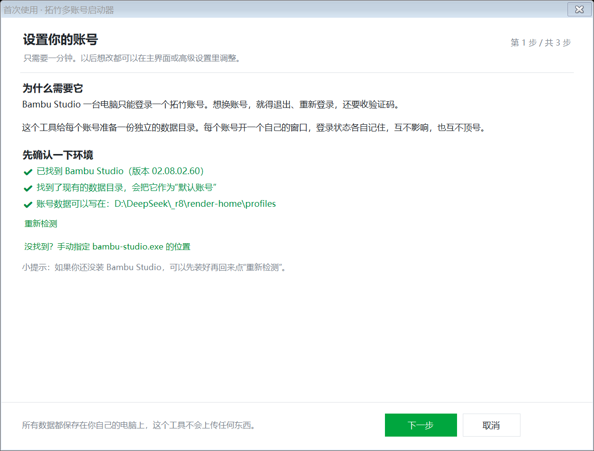
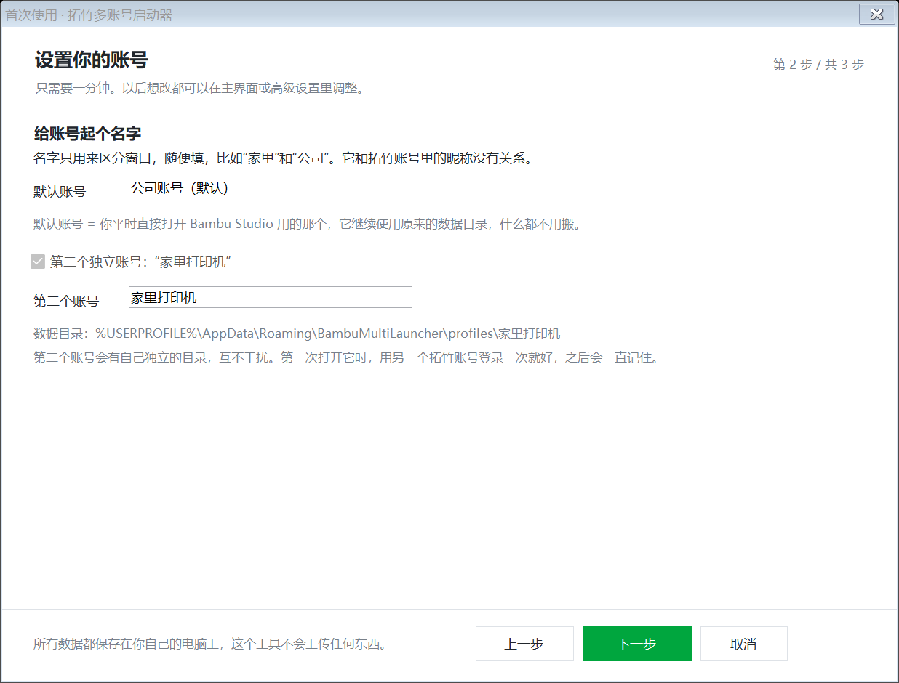
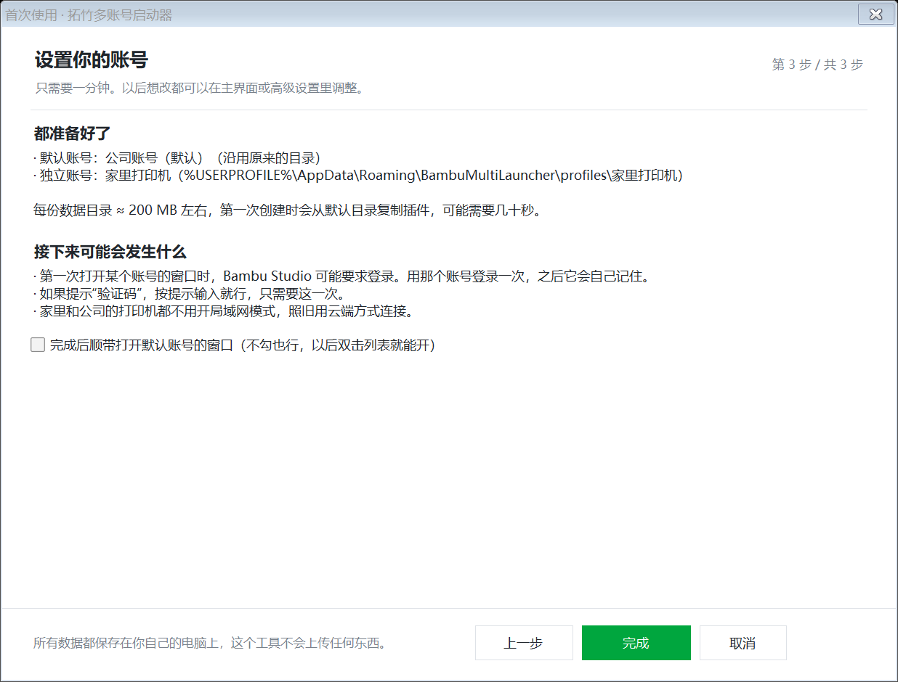
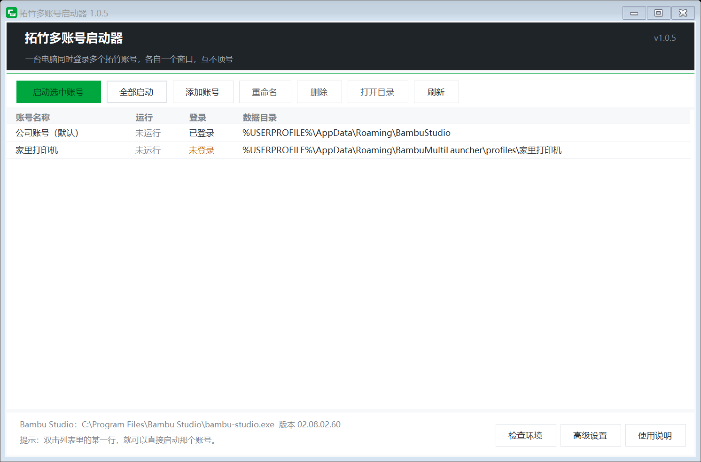
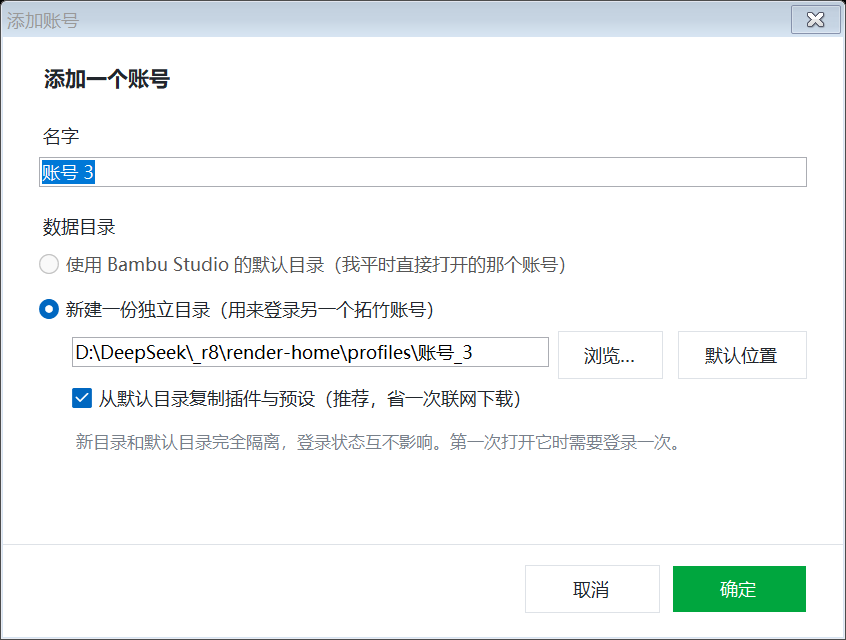
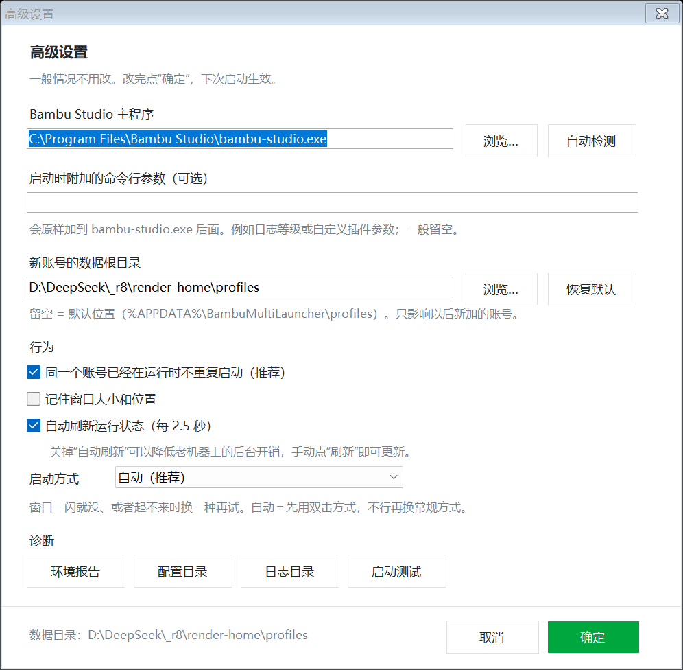

# 使用手册

> 截图里的路径、账号名是示例，实际以你自己的为准。

## 目录

- [装之前](#装之前)
- [第一次使用](#第一次使用)
- [日常使用](#日常使用)
- [添加/删除/重命名账号](#添加删除重命名账号)
- [高级设置](#高级设置)
- [检查环境](#检查环境)
- [换电脑、备份、清理](#换电脑备份清理)

---

## 装之前

- Windows 10 或 Windows 11（64 位）。
- 已经装好 Bambu Studio（任意较新版本）。
- 磁盘至少留 **1 GB**（每多一个账号，数据目录约 200 MB）。
- 解压位置**不要**放在 OneDrive / 百度网盘 / 坚果云这类会同步的目录里：两份数据目录加起来几百 MB，同步会卡，而且登录文件被同步工具反复读写容易出问题。

## 第一次使用

### 1. 打开程序

双击 `拓竹多账号启动器.exe`。第一次会弹三步向导。

### 2. 确认环境

向导自动检查三件事：

- ✔ 找到 Bambu Studio（显示版本号）
- ✔ 找到现有的数据目录（会把它当作"默认账号"）
- ✔ 账号数据可以写在你指定的位置

有 ✖ 就先点"重新检测"；还不行点"手动指定 bambu-studio.exe 的位置"，自己选一下。

### 3. 起名字

- **默认账号**：你平时直接打开 Bambu Studio 用的那个账号。名字随便填，只是给你自己看。
- **第二个账号**：勾上"我再添加一个独立账号"，起个名字（比如"家里打印机"）。它会新建一份独立的数据目录。

> 名字和拓竹账号里的昵称没有关系，纯粹是窗口标签。名字里的空格、`/` 等字符会被自动替换成 `_` 用作目录名。

### 4. 完成

勾"完成后立刻启动所有账号窗口"，点"完成"。

新账号的窗口第一次打开时，Bambu Studio 会让你登录。**用那个账号登录一次，填一次验证码**，之后就一直记住了。

> 如果某个窗口打开后是"默认账号"的登录状态，说明目录复制有问题，请到 [常见问题](常见问题.md) 看"两个窗口是同一个账号"。

## 日常使用

| 操作 | 结果 |
|---|---|
| 双击列表某一行 | 启动这个账号。已经开着的话，把它的窗口切到前面 |
| 启动选中账号 / 全部启动 | 同上，一次开一个 / 一次全开 |
| 右键一行 | 启动、打开数据目录、复制目录路径、删除 |
| 刷新 | 立刻更新"运行中/未运行"状态（平时每 2.5 秒自动刷新） |

列表说明：

- **运行**：`运行中` = 这个账号的 Bambu Studio 窗口正在跑；`未运行` = 没开。
- **登录**：`已登录` = 这份数据目录里已经有登录凭据；`未登录` = 还没登录过（或者被清掉了）。
- **数据目录**：`%USERPROFILE%` 开头是省略写法，鼠标右键"复制目录路径"能得到完整路径。

## 添加/删除/重命名账号

**添加**（工具栏"添加账号"）：

- 名字必填，重名会被拦下。
- **使用 Bambu Studio 的默认目录**：只在你想把默认账号换个名字时用；一般选下面的"新建一份独立目录"。
- **从默认目录复制插件与预设**：推荐勾上，省得新账号第一次打开时重新下载网络插件（几十 MB）。复制过程会**主动删掉**目标目录里的登录文件，不会把默认账号的登录状态带过去。

**重命名**：只改显示名字，不动目录。已经开着的窗口不受影响。

**删除**：只从列表里移除，**不会删目录里的数据**。想彻底清掉，删除后自己去 `%APPDATA%\BambuMultiLauncher\profiles` 里把它删了。

> 默认账号不能删除（它的数据目录属于 Bambu Studio 本身）。

## 高级设置

一般情况不用动。

| 项目 | 说明 |
|---|---|
| Bambu Studio 主程序 | 换版本、换了安装路径时用"浏览…"或"自动检测" |
| 启动时附加的命令行参数 | 会原样拼在 `bambu-studio.exe` 后面。不知道就别填 |
| 新账号的数据根目录 | 只是**以后新加**账号的默认位置；已有账号不受影响。留空 = 默认位置 |
| 同一个账号已经在运行时不重复启动 | 推荐开着。关掉的话，同一账号可能开出两个窗口，登录状态会打架 |
| 记住窗口大小和位置 | 关掉则每次都用默认尺寸 |
| 自动刷新运行状态 | 关掉能少一点后台查询（每 2.5 秒一次），手动点"刷新" |
| 启动方式 | **自动（推荐）**：先按双击快捷方式的方式打开，不行再换常规方式。**双击方式**：和你在资源管理器里双击 `bambu-studio.exe` 完全一样。**常规方式**：直接创建进程并带命令行参数。某台电脑上只有一种能起来时，在这里固定成那一种 |

右下角四个诊断按钮：

- **环境报告**：系统版本、Bambu Studio 候选位置、数据目录、账号列表、正在运行的实例。提 issue 时请贴这个。
- **配置目录** / **日志目录**：直接打开资源管理器（打开后会自动切到前面；打不开会说明原因）。
- **启动测试**：用两种启动方式各试一次，报告哪种能起来——换电脑后先点这个最省事。

## 检查环境

主界面右下角"检查环境"会重新检测 Bambu Studio 是否还在、默认数据目录是否还在。升级或重装 Bambu Studio 之后点一下最稳。

左下角会显示当前用的主程序路径和版本；找不到时是橙色提示。

## 换电脑、备份、清理

**换电脑**：把 `%APPDATA%\BambuMultiLauncher` 整个目录拷到新电脑的同一位置（程序重新解压一份即可）。各账号的登录状态都在这份目录里。

> 拷之前先关掉所有 Bambu Studio 窗口，避免文件正在被写。

**备份**：同上，备份 `%APPDATA%\BambuMultiLauncher` 就够了。

**清理**：

1. 删掉程序目录。
2. 删掉 `%APPDATA%\BambuMultiLauncher`。
3. **不要删** `%APPDATA%\BambuStudio`——那是你原来的默认账号，本工具没动过它。
## 窗口没启动成功怎么办

1. 在列表里**右键**那个账号 → **诊断启动问题…**。
2. 等十几秒，程序会：
   - 先用"双击方式"启动一次，记录进程活了多久、退出码；
   - 检查目标目录有没有被写入；
   - 不行就再用"常规方式"启动一次；
   - 如果怀疑是 `single_instance` 的关系（新加的账号），自动备份并修好，再试一次。
3. 最后弹出一份中文报告，结论会直接写"启动成功 / 双击方式不行但常规方式可以 / 两种都没起来"，并说明退出码的含义（比如 `0xC0000409` = Bambu Studio 自己崩了）。

**如果报告说只有某一种方式能起来**：打开 **高级设置 → 启动方式**，选那一种，以后就一直用它。

**如果两种都起不来**：先手动双击一次 Bambu Studio 原版快捷方式，确认它本身能打开。它自己能开、而这个工具开不了的话，把两份报告（环境报告 + 启动诊断）发给开发者。

报告可以直接复制。同样的测试在 **高级设置 → 启动测试** 里也能跑。

## 以前装过这个工具 / 用过脚本

不用手动搬数据。启动时自动扫描以前的账号目录，认回来的会显示成"以前的账号（…）"，登录状态还在，双击就能用。

用不上的右键删除即可（默认只从列表里移除，不删数据；删除时会问你要不要连数据一起删）。
